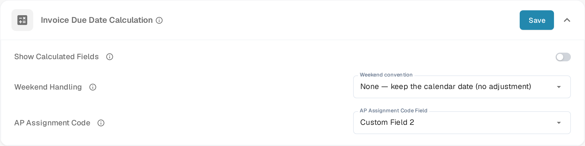
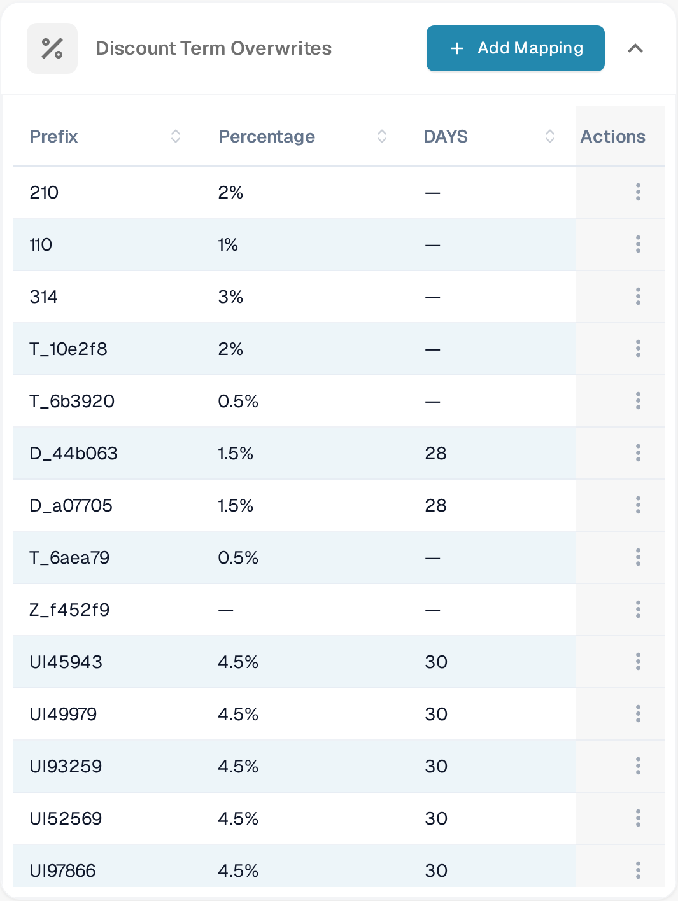
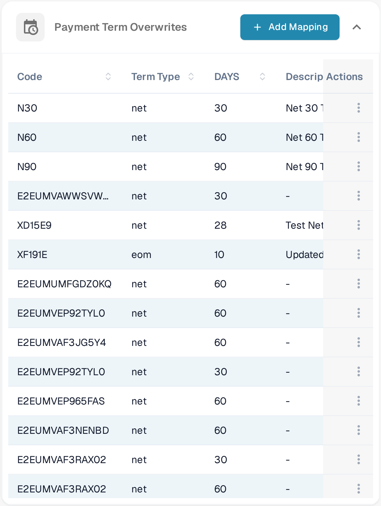
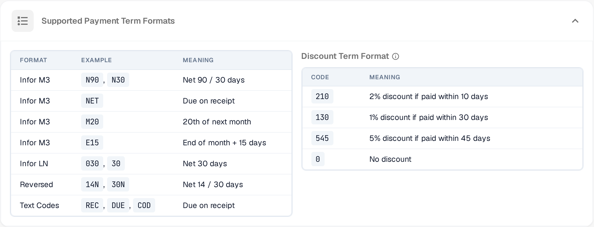

# Obračun roka dospeća

<figure><figcaption>
Podešavanja obračuna roka dospeća
</figcaption></figure>

Stranica **Obračun roka dospeća** (**Obrada dokumenata → Obračun roka dospeća**) kontroliše kako DocBits obračunava rokove dospeća faktura, rokove dospeća popusta (Skonto) i uslove plaćanja na osnovu kodova uslova plaćanja pronađenih na fakturama.

Kartica **Invoice Due Date Calculation** sadrži opšta podešavanja. Izmene u ovoj kartici čuvate dugmetom **Save** u zaglavlju kartice. Ispod su tabele zamena za popuste i uslove plaćanja, kao i pregled podržanih formata.

## Show Calculated Fields

Uključite **Show Calculated Fields** da bi se automatski obračunata polja fakture — rok dospeća, rok dospeća popusta, uslovi plaćanja i AP kod dodele — pojavila u podešavanjima polja i kao promenljive u brzoj pretrazi i šablonima e-pošte. Prilagođeni tipovi dokumenata nikada nisu obuhvaćeni.

## Invoice Due Date Calculation

### Weekend Handling

Izaberite **Weekend convention** da odredite kako se prilagođava rok dospeća koji padne na subotu ili nedelju. Pravilo važi **i** za rok dospeća fakture **i** za rok dospeća popusta (Skonto).

| Konvencija | Efekat |
|------------|--------|
| **None** | Zadržava kalendarski datum, bez prilagođavanja. |
| **Following** | Pomera subotu/nedelju na sledeći ponedeljak. |
| **Preceding** | Pomera subotu/nedelju na prethodni petak. |
| **Nearest** | Subota → petak, nedelja → ponedeljak. |
| **Modified Following** | Sledeći ponedeljak, osim ako pređe u sledeći mesec — tada prethodni petak. |

### AP Assignment Code

Izaberite **AP Assignment Code Field** da biste uslove plaćanja dobavljača povezali sa AP kodovima dodele za automatsko usmeravanje faktura.

## Discount Term Overwrites

<figure><figcaption>
Discount Term Overwrites
</figcaption></figure>

Tabelu **Discount Term Overwrites** koristite da povežete određeni prefiks sa procentom popusta i brojem dana. Kliknite na **Add Mapping** da dodate red sa poljima **Prefix**, **Percentage** i brojem dana. Da izmenite ili uklonite postojeće mapiranje, otvorite meni (⋮) na kraju reda.

## Payment Term Overwrites

<figure><figcaption>
Payment Term Overwrites
</figcaption></figure>

U tabeli **Payment Term Overwrites** povežite kod uslova plaćanja sa tipom roka, brojem dana i opisom. Kliknite na **Add Mapping** za novi red sa poljima **Code**, **Term Type**, broj dana i **Description**, a menijem (⋮) na kraju reda izmenite ili obrišite mapiranje.

## Podržani formati

<figure><figcaption>
Podržani formati uslova plaćanja i popusta
</figcaption></figure>

DocBits prepoznaje sledeće kodove uslova plaćanja i popusta.

**Podržani formati uslova plaćanja**

| Format | Primer | Značenje |
|--------|--------|----------|
| Infor M3 | `N90`, `N30` | Neto 90 / 30 dana |
| Infor M3 | `NET` | Plativo po prijemu |
| Infor M3 | `M20` | 20. u sledećem mesecu |
| Infor M3 | `E15` | Kraj meseca + 15 dana |
| Infor LN | `030`, `30` | Neto 30 dana |
| Reversed | `14N`, `30N` | Neto 14 / 30 dana |
| Tekstualni kodovi | `REC`, `DUE`, `COD` | Plativo po prijemu |

**Format uslova popusta** — uslovi popusta kodiraju popuste za rano plaćanje kao trocifrene kodove: prva cifra je procenat popusta, poslednje dve su dani u okviru kojih treba platiti.

| Kod | Značenje |
|-----|----------|
| `210` | 2% popusta ako se plati u roku od 10 dana |
| `130` | 1% popusta ako se plati u roku od 30 dana |
| `545` | 5% popusta ako se plati u roku od 45 dana |
| `0` | Bez popusta |
