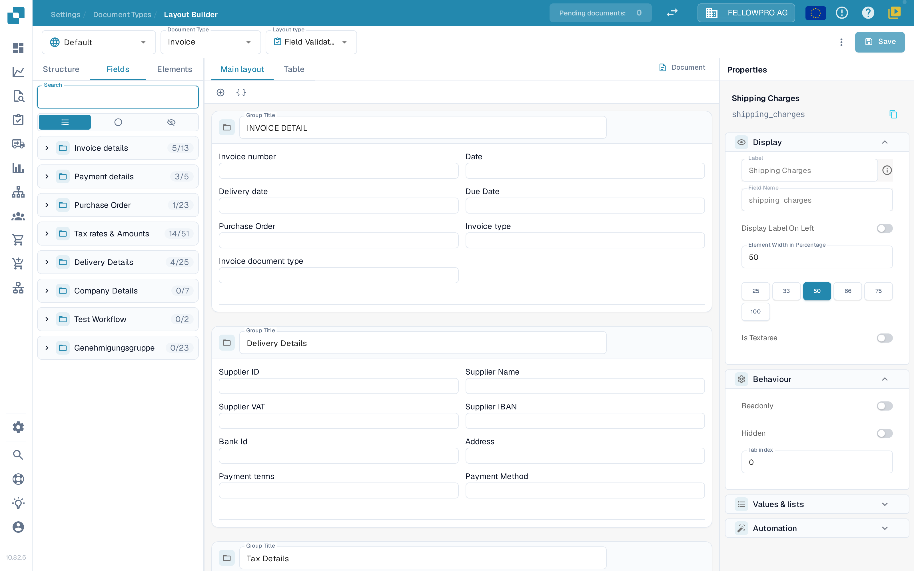
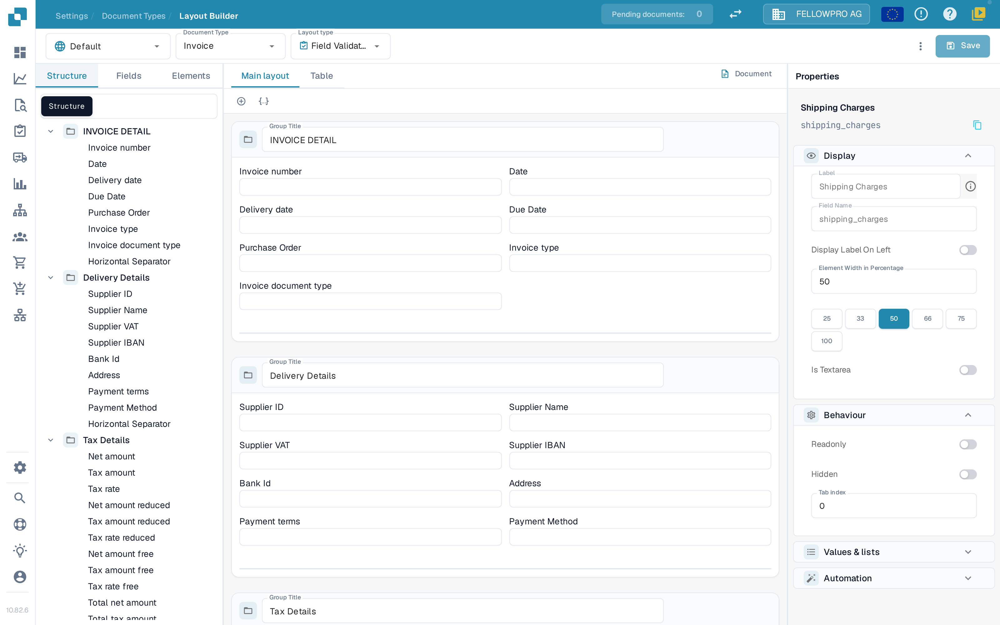

# Layout Builder

Pomoću alata **Layout Builder** raspoređujete polja i kontrole koje vide osobe kada potvrđuju ili odobravaju dokument. Jedan raspored pripada tačno jednom tipu dokumenta, jednom poreklu i jednom tipu rasporeda, pa proverite ta tri izbora na vrhu stranice pre nego što sačuvate.

## Otvaranje rasporeda

1. Otvorite **Settings → Document Types**.
2. Izaberite tip dokumenta koji želite da uredite i otvorite **Layout Builder**. Za podtip dokumenta koristite akciju Layout Builder tog podtipa.
3. Proverite zaglavlje. Levi birač je **poreklo** (na primer **Default**), zatim slede **Document Type** (na primer **Invoice**) i **Layout type** (na primer **Field Validation**). Svaki birač otvara listu; izborom druge stavke učitava se odgovarajući raspored. Ako **Layout Builder** nije dostupan, administrator možda treba da omogući modul za vašu organizaciju.

<figure><figcaption>
Layout Builder: birači u zaglavlju, liste elemenata sa leve strane, radna površina u sredini i panel Properties sa desne strane.
</figcaption></figure>

## Rad sa zaglavljem

* **Document Type** i **Layout type** prebacuju između rasporeda. Stranica ponovo učitava raspored koji izaberete.
* Pored dugmeta **Save**, DocBits prikazuje da li raspored ima nesačuvane izmene. Nakon čuvanja vidi se kada je raspored poslednji put sačuvan.
* **Save** čuva raspored za izabrani tip dokumenta, poreklo i tip rasporeda.
* Meni **More** (tri tačke) sadrži **Auto Generate template**, **Apply Default layout to Origins**, **Use default template**, **Edit JSON**, **Copy JSON** i **Layout settings**. **Auto Generate template** i **Use default template** zamenjuju prilagođeni raspored, pa prvo proverite izabrani tip dokumenta i raspored. **Edit JSON** je namenjen naprednom podešavanju i treba ga koristiti samo ako poznajete format šablona.
* Ako napustite stranicu sa nesačuvanim izmenama, DocBits pita da li da ih sačuva ili odbaci.

## Pronalaženje elemenata: Structure, Fields, Elements

Sa leve strane nalaze se tri kartice:

| Kartica | Čemu služi |
| --- | --- |
| **Structure** | Prikazuje raspored kao stablo. Grupe i njihova polja navedeni su redom kojim se pojavljuju na radnoj površini, uz broj postavljenih i dostupnih polja. |
| **Fields** | Sva polja podešena za taj tip dokumenta, grupisana po grupi polja i podrazumevano skupljena. Filter prebacuje između svih, neiskorišćenih i skrivenih polja, a tehnički naziv polja prikazan je ispod oznake polja. |
| **Elements** | Kontrole za prikaz i interakciju, kao što su tekst, oznaka, polje za potvrdu, separatori, tabele, dugmad i podgrupe. |

<figure><figcaption>
Kartica Structure prikazuje izgrađeni raspored kao stablo grupa i polja.
</figcaption></figure>

Izaberite stavku da biste je dodali ili je prevucite na radnu površinu. Naslov grupe govori osobi koja potvrđuje dokument šta pripada tom odeljku. Polja dokumenta koja se ponovo koriste prvo kreirajte ili preimenujte u odeljku [Document Types](README.md).

## Rad na radnoj površini

* **Main layout** prikazuje raspored samog dokumenta. **Table** prikazuje raspored tabele koji se koristi za stavke.
* **Document** otvara ili zatvara primer dokumenta pored radne površine, pa možete da uporedite raspored sa stvarnim dokumentom.
* Grupe se prikazuju kao kartice; polja unutar grupe mogu da se rasporede u redove i da dobiju različite širine.

## Promena svojstava elementa

Izaberite element ili grupu na radnoj površini. Panel **Properties** sa desne strane uvek je vidljiv i podeljen je na odeljke:

* **Display** – oznaka, naziv polja, položaj oznake i širina elementa.
* **Behaviour** – samo za čitanje, skriveno i redosled tabulatora.
* **Values & lists** – vrednosti ponuđene za element.
* **Automation** – pravila koja popunjavaju ili menjaju element.
* **Borders & spacing** – izgled elementa.

Za širinu izaberite jednu od ponuđenih vrednosti (25, 33, 50, 66, 75 ili 100 procenata) umesto da upisujete broj i proverite rezultat na radnoj površini. Koji se odeljci i opcije pojavljuju zavisi od izabranog elementa.

## Provera i čuvanje

Rasporedite grupe i polja, proverite raspored na radnoj površini i upotrebite **Save** u zaglavlju kada je rezultat ispravan. Za rasporede specifične za poreklo pogledajte [Origin Layouts](origin-layouts.md).


Snimci ekrana prikazuju sintetička podešavanja u DocBits test organizaciji, sa aplikacijom na engleskom jeziku, jer aplikacija nema srpski interfejs. Prilikom snimanja nijedan raspored nije sačuvan niti zamenjen.

