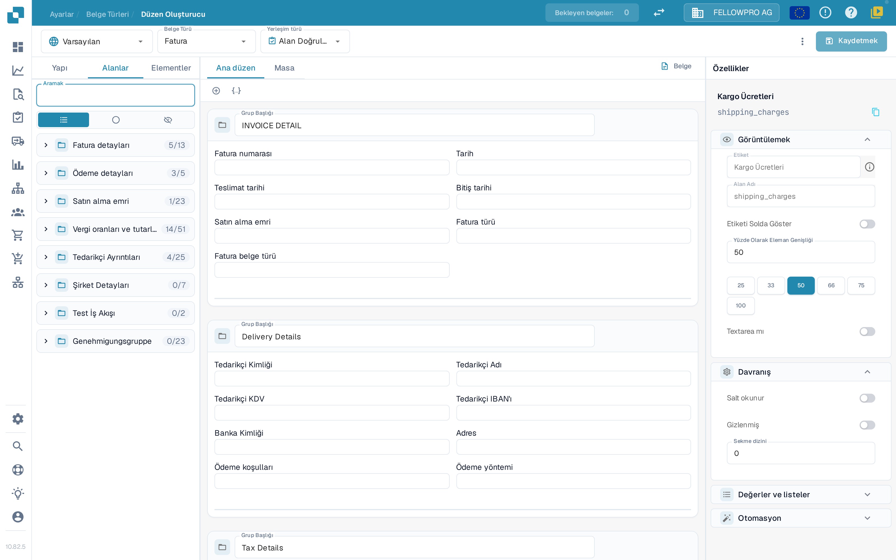
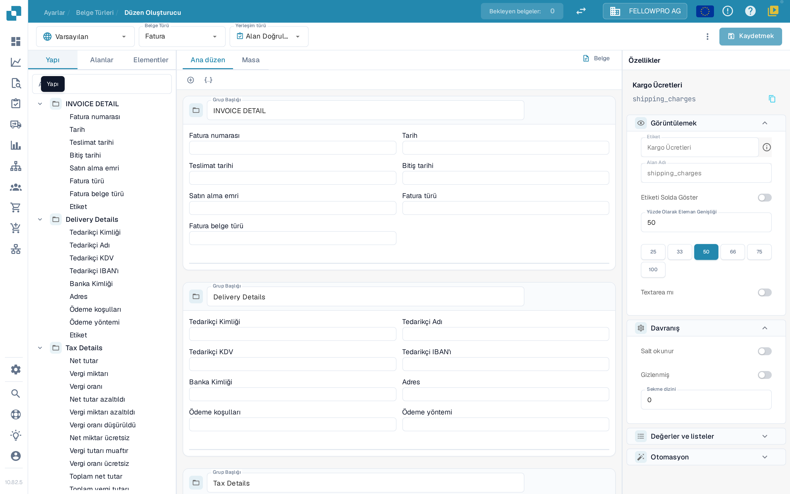

# Layout Builder

Düzen Oluşturucu ile, bir belgeyi doğrulayan veya onaylayan kişilerin gördüğü alanları ve denetimleri düzenlersiniz. Bir düzen tek bir belge türüne, tek bir kaynağa ve tek bir düzen türüne aittir; kaydetmeden önce sayfanın üst kısmındaki bu üç seçimi kontrol edin.

## Düzeni açma

1. **Ayarlar → Belge Türleri** bölümünü açın.
2. Düzenlemek istediğiniz belge türünü seçin ve **Düzen Oluşturucu**'yu açın. Bir alt belge türü için o alt türün Düzen Oluşturucu eylemini kullanın.
3. Üst bilgi alanını kontrol edin. Soldaki seçici **kaynaktır** (örneğin **Varsayılan**), ardından **Belge Türü** (örneğin **Fatura**) ve **Yerleşim Türü** (örneğin **Alan Doğrulama**) gelir. Her seçici bir liste açar; başka bir giriş seçtiğinizde ilgili düzen yüklenir. Düzen Oluşturucu kullanılamıyorsa, bir yöneticinin modülü kuruluşunuz için etkinleştirmesi gerekebilir.

<figure><figcaption>
Düzen Oluşturucu: üst bilgideki seçiciler, soldaki element listeleri, ortadaki tuval ve sağdaki Özellikler paneli.
</figcaption></figure>

## Üst bilgi alanıyla çalışma

* **Belge Türü** ve **Yerleşim Türü** düzenler arasında geçiş yapar. Seçtiğiniz düzen sayfaya yeniden yüklenir.
* **Kaydetmek** düğmesinin yanında DocBits, düzende kaydedilmemiş değişiklik olup olmadığını gösterir. Kaydettikten sonra düzenin en son ne zaman kaydedildiği görünür.
* **Kaydetmek**, düzeni seçili belge türü, kaynak ve yerleşim türü için saklar.
* Üç noktalı **daha fazla** menüsü şablonu otomatik oluşturma, varsayılan düzeni kaynaklara uygulama, varsayılan şablonu kullanma, JSON düzenleme, JSON kopyalama ve düzen ayarlarını içerir. Şablonu otomatik oluşturma ve varsayılan şablonu kullanma, özel bir düzenin yerine geçer; bu nedenle önce seçili belge türünü ve düzeni kontrol edin. JSON düzenleme gelişmiş yapılandırma içindir ve yalnızca şablon biçimini bildiğinizde kullanılmalıdır.
* Sayfadan kaydedilmemiş değişikliklerle ayrılırsanız DocBits, bunları kaydetmek mi yoksa atmak mı istediğinizi sorar.

## Elementleri bulma: Yapı, Alanlar, Elementler

Sol tarafta üç sekme bulunur:

| Sekme | Ne için kullanılır |
| --- | --- |
| **Yapı** | Düzeni ağaç olarak gösterir. Gruplar ve alanları, tuvalde göründükleri sırada, yerleştirilen ve kullanılabilir alan sayısıyla birlikte listelenir. |
| **Alanlar** | Belge türü için yapılandırılmış tüm alanlar; alan grubuna göre gruplanır ve varsayılan olarak kapalıdır. Filtre tüm, kullanılmayan ve gizli alanlar arasında geçiş yapar; teknik alan adı, alan etiketinin altında gösterilir. |
| **Elementler** | Metin, etiket, onay kutusu, ayırıcı, tablo, düğme ve alt grup gibi sunum ve etkileşim denetimleri. |

<figure><figcaption>
Yapı sekmesi, oluşturulan düzeni gruplardan ve alanlardan oluşan bir ağaç olarak gösterir.
</figcaption></figure>

Bir öğeyi eklemek için seçin veya tuvale sürükleyin. Grup başlığı, belgeyi doğrulayan kişiye o bölüme neyin ait olduğunu anlatır. Yeniden kullanılabilir belge alanlarını önce [Belge Türleri](README.md) bölümünde oluşturun veya yeniden adlandırın.

## Tuval üzerinde çalışma

* **Ana düzen**, belgenin kendi düzenini gösterir. **Masa**, kalem satırları için kullanılan tablo düzenini gösterir.
* **Belge**, tuvalin yanındaki örnek belgeyi açar veya kapatır; böylece düzeni gerçek bir belgeyle karşılaştırabilirsiniz.
* Gruplar kart olarak çizilir; bir grubun içindeki alanlar satırlar hâlinde düzenlenebilir ve farklı genişlikler alabilir.

## Bir elementin özelliklerini değiştirme

Tuvalde bir element veya grup seçin. Sağdaki **Özellikler** paneli her zaman görünür ve bölümlere ayrılmıştır:

* **Görüntülemek** – etiket, alan adı, etiket konumu ve element genişliği.
* **Davranış** – salt okunur, gizlenmiş ve sekme düzeni.
* **Değerler ve listeler** – element için sunulan değerler.
* **Otomasyon** – elementi dolduran veya değiştiren kurallar.
* **Kenarlıklar ve boşluklar** – elementin görünümü.

Genişlik için bir değer yazmak yerine hazır değerlerden birini seçin (yüzde 25, 33, 50, 66, 75 veya 100) ve sonucu tuvalde kontrol edin. Hangi bölümlerin ve seçeneklerin göründüğü, seçili elemente bağlıdır.

## Gözden geçirme ve kaydetme

Grupları ve alanları düzenleyin, düzeni tuvalde kontrol edin ve sonuç doğru olduğunda üst bilgideki **Kaydetmek** düğmesini kullanın. Kaynağa özgü düzenler için bkz. [Origin Layouts](origin-layouts.md).


Ekran görüntüleri, uygulama Türkçe diline ayarlıyken DocBits test kuruluşundaki yapay ayarları gösterir. Görüntüler alınırken hiçbir düzen kaydedilmedi veya değiştirilmedi.

