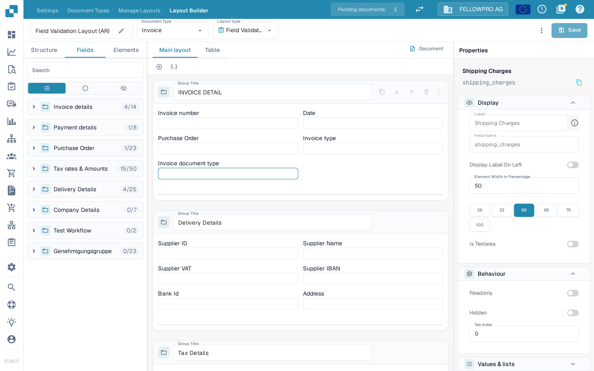
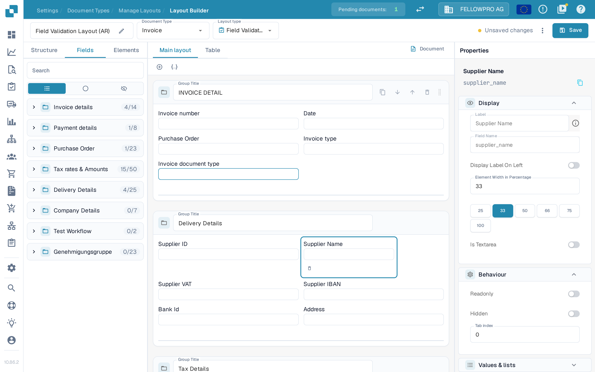
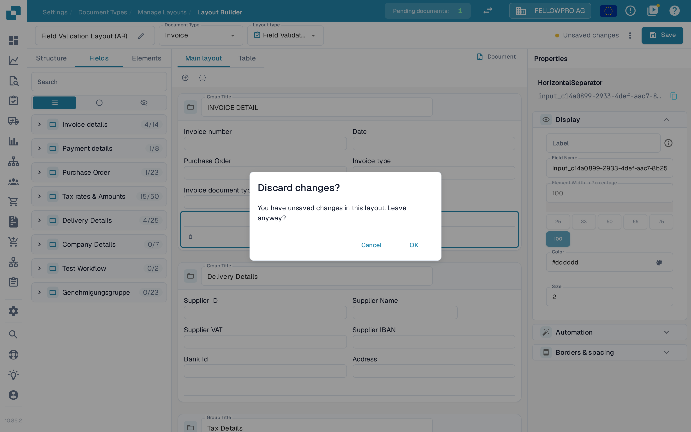
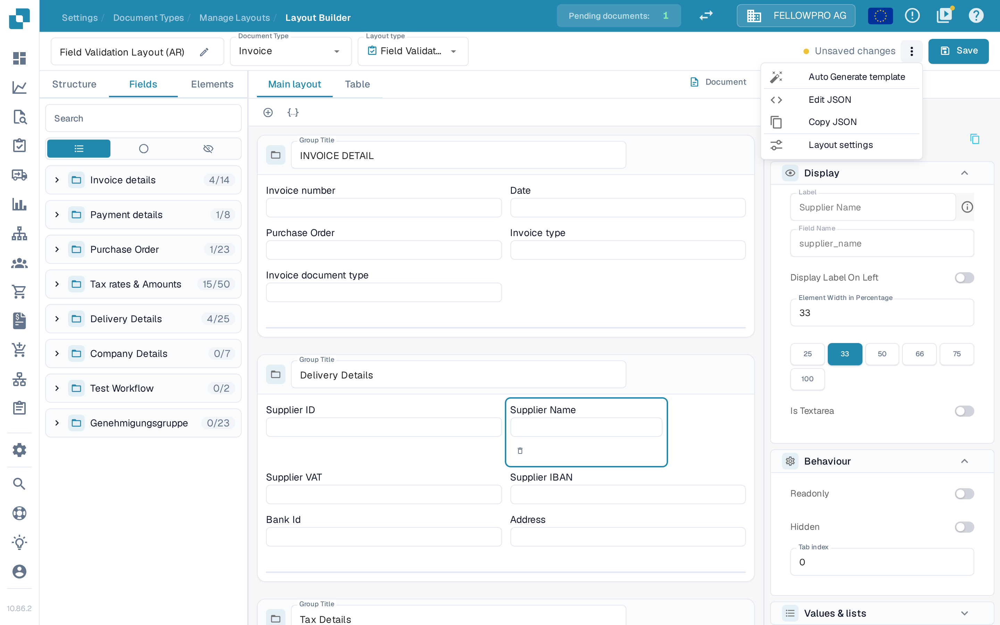

# Čuvanje i primena izmena

Izmene napravljene u alatu Layout Builder stupaju na snagu tek kada ih sačuvate. Čuvanjem se raspored vezuje za tip dokumenta, pa ga novi dokumenti koriste.

## Čuvanje izmena

Pošto uredite raspored, u zaglavlju gore desno izaberite **Save**.

<figure><figcaption>
Dugme <strong>Save</strong> nalazi se gore desno u alatu Layout Builder.
</figcaption></figure>

Dok radite, zaglavlje prikazuje stanje vaših izmena:

* Dugme **Save** bez poruke pored njega znači da raspored nije menjan.
* Poruka **Unsaved changes** pojavljuje se čim izmenite raspored. Izaberite **Save** da biste izmene sačuvali.

<figure><figcaption>
Oznaka <strong>Unsaved changes</strong> vidi se dok raspored još nije sačuvan.
</figcaption></figure>

Nakon uspešnog čuvanja, oznaku zamenjuje vreme poslednjeg čuvanja. Ponovni izbor dugmeta **Save** je bezbedan: ako se od poslednjeg čuvanja ništa nije promenilo, ništa se ni ne upisuje.

Ako napustite Layout Builder sa nesačuvanim izmenama, DocBits pita **Discard changes?**. Izaberite **Cancel** da biste ostali i sačuvali izmene ili **OK** da biste izašli bez čuvanja.

<figure><figcaption>
Potvrda koja se prikazuje pri izlasku sa nesačuvanim izmenama.
</figcaption></figure>

## Ostale radnje u zaglavlju

Meni sa tri tačke pored dugmeta **Save** sadrži preostale radnje nad rasporedom:

* **Auto Generate template** – automatski gradi raspored od polja tog tipa dokumenta.
* **Edit JSON** – uređuje definiciju rasporeda direktno u JSON formatu.
* **Copy JSON** – kopira definiciju rasporeda u privremenu memoriju.
* **Layout settings** – otvara opšta podešavanja rasporeda.

**Auto Generate template** zamenjuje postojeći raspored, pa prvo proverite koji je raspored otvoren. **Edit JSON** je namenjen naprednim korisnicima i treba ga koristiti samo ako poznajete format šablona.

<figure><figcaption>
Radnje dostupne u meniju sa tri tačke.
</figcaption></figure>

## Primena izmena

Kada je raspored sačuvan, tok obrade dokumenata za taj tip dokumenta koristi ga ovako:

* Novi dokumenti obrađeni tim tipom dokumenta koriste ažurirani raspored.
* Već obrađeni dokumenti zadržavaju raspored sa kojim su zabeleženi.

## Provera izmena

Posle čuvanja otvorite dokument tog tipa i proverite da li se polja i grupe prikazuju onako kako ste zamislili. Ako nešto nedostaje, vratite se u Layout Builder, ispravite raspored i ponovo sačuvajte.


Snimci ekrana prikazuju aplikaciju na engleskom jeziku, jer aplikacija nema srpski interfejs. Nazivi dugmadi i poruka na slikama zato su na engleskom.

