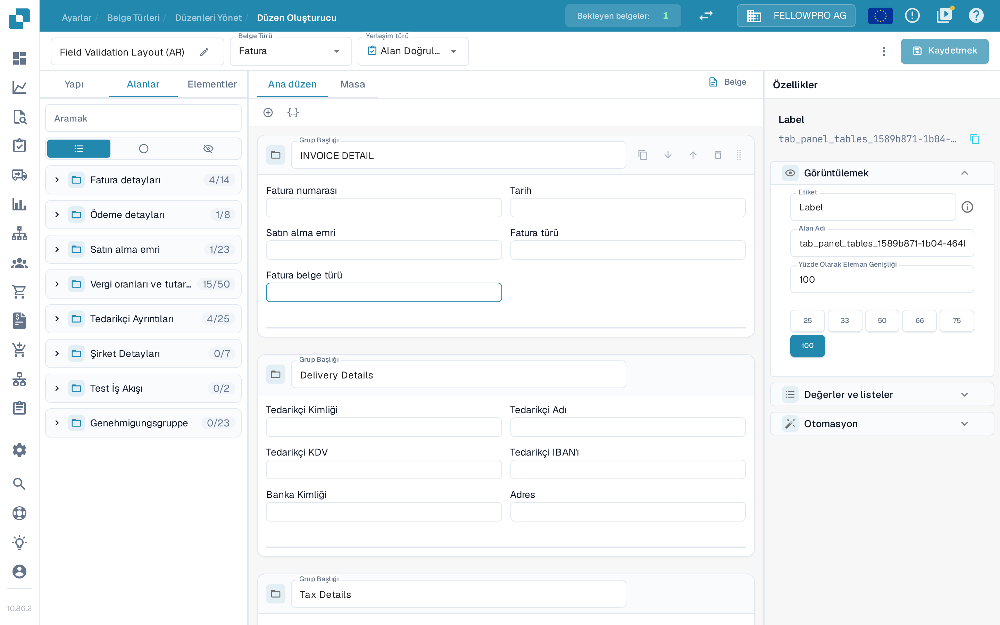
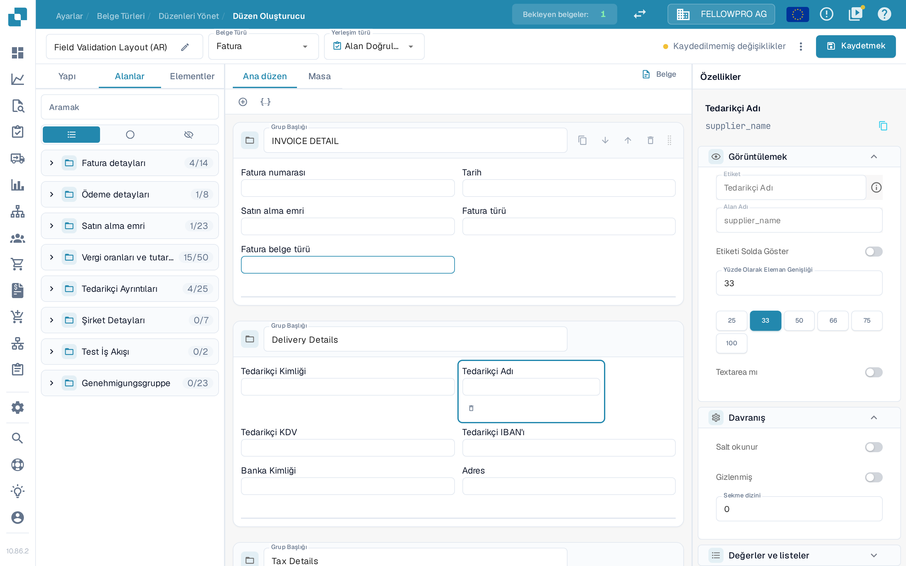
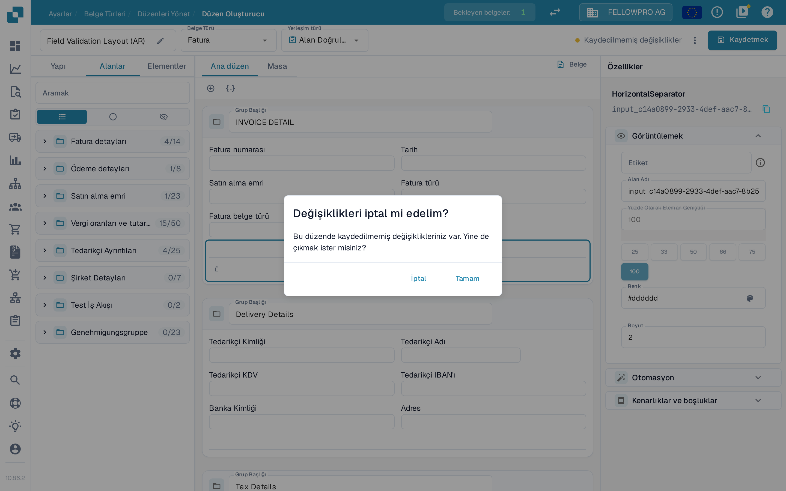
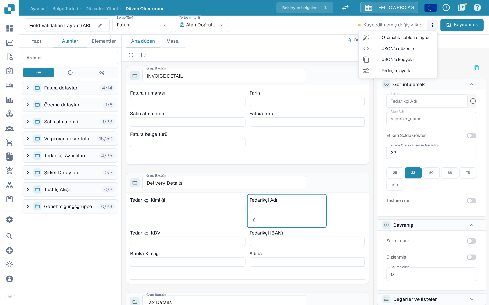

# Değişiklikleri Kaydetme ve Uygulama

Layout Builder'da yaptığınız değişiklikler, siz kaydedene kadar geçerli olmaz. Kaydettiğinizde düzen, belge türüne bağlanır ve yeni belgeler bu düzeni kullanır.

## Değişikliklerinizi kaydetme

Düzeni düzenledikten sonra, üst çubuğun sağ üst köşesindeki **Kaydetmek** seçeneğini seçin.

<figure><figcaption>**Kaydetmek** düğmesi Layout Builder'ın sağ üst köşesinde bulunur.</figcaption></figure>

Siz çalışırken üst çubuk, değişikliklerinizin durumunu gösterir:

* Yanında herhangi bir ileti bulunmayan bir **Kaydetmek** düğmesi, düzenin değişmediği anlamına gelir.
* Düzeni değiştirdiğiniz anda **Kaydedilmemiş değişiklikler** görünür. Değişiklikleri saklamak için **Kaydetmek** seçeneğini seçin.

<figure><figcaption>Düzen henüz kaydedilmediği sürece **Kaydedilmemiş değişiklikler** uyarısı görünür.</figcaption></figure>

Kayıt başarıyla tamamlandığında bu uyarının yerini düzenin en son kaydedildiği saat alır. **Kaydetmek** seçeneğini yeniden seçmek sakıncalı değildir: son kayıttan bu yana hiçbir şey değişmediyse hiçbir şey yazılmaz.

Layout Builder'dan kaydedilmemiş değişikliklerle ayrılmak isterseniz DocBits **Değişiklikleri iptal mi edelim?** diye sorar. Sayfada kalıp kaydetmek için **İptal**, kaydetmeden çıkmak için **Tamam** seçeneğini seçin.

<figure><figcaption>Kaydedilmemiş değişikliklerle çıkarken görünen onay.</figcaption></figure>

## Üst çubuktaki diğer işlemler

**Kaydetmek** düğmesinin yanındaki üç nokta menüsü, diğer düzen işlemlerini içerir:

* **Otomatik şablon oluştur** – belge türünün alanlarından otomatik olarak bir düzen oluşturur.
* **JSON'u düzenle** – düzen tanımını doğrudan JSON olarak düzenler.
* **JSON'u kopyala** – düzen tanımını panoya kopyalar.
* **Yerleşim ayarları** – düzenin genel ayarlarını açar.

**Otomatik şablon oluştur**, mevcut düzenin yerine geçer; bu nedenle önce hangi düzenin açık olduğunu denetleyin. **JSON'u düzenle** ileri düzey kullanıcılara yöneliktir ve yalnızca şablon biçimini biliyorsanız kullanılmalıdır.

<figure><figcaption>Üç nokta menüsündeki işlemler.</figcaption></figure>

## Değişiklikleri uygulama

Düzen kaydedildikten sonra, o belge türüne ait belge işleme akışı bu düzeni kullanır:

* Bu belge türüyle işlenen yeni belgeler güncellenmiş düzeni kullanır.
* Daha önce işlenmiş belgeler, yakalandıkları sırada kullanılan düzeni korur.

## Değişiklikleri test etme

Kaydettikten sonra bu belge türüne ait bir belgeyi açın ve alanlarla grupların beklediğiniz gibi göründüğünü denetleyin. Eksik bir şey varsa Layout Builder'a dönün, düzeni düzeltin ve yeniden kaydedin.
