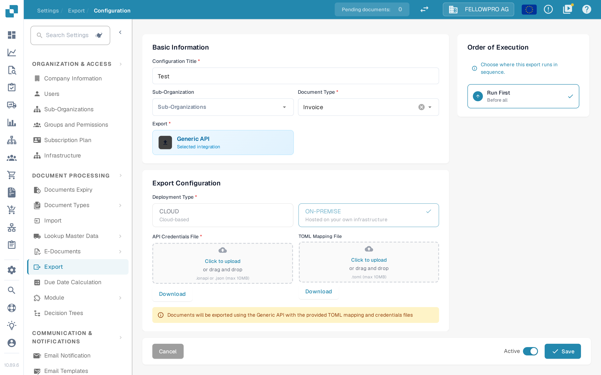

# Export Module

The export module is located, on the Dashboard, under Settings → Document Processing → Export.

## New Export

To add a new export configuration, select “+ New”&#x20;

Select the method you would like to use for your export configuration.

Once you have selected the method you would like to use, you will need to upload the various information and files required for that method of exporting.

## Activate/Deactivate

Once you have one or many export configurations in your DocBits, you have the option to activate or deactivate configurations depending on your needs.

The configuration below is activated, indicated by the green dot to the left of the configuration name.

To deactivate the export configuration, select the options button to the right of the configuration as shown below.

You are given three options

* Deactivate: The export configuration will no longer be functional (indicated by a red dot next to the configuration name).
* Edit: Make changes to the details of the configuration.
* Delete: Delete the configuration.

### Activate on the edit screen

An existing configuration also has an **Active** switch in the footer of its edit screen, next to **Save**.

1. Open the configuration with **Edit**.
2. Set the **Active** switch to the state you want and select **Save**.

DocBits then activates or deactivates the configuration with the same checked call the list uses: if another configuration for the same document type is already active, activating is rejected. Saving the form no longer changes the stored active state on its own, and the footer switch and a watcher's **Enabled** control always show the same state.

<figure><figcaption>
The Active switch next to Save on the export configuration edit screen.
</figcaption></figure>

